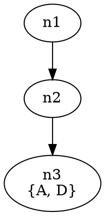

# VennDAG

**VennDAG** is a prototype tool for minimal reachability-preserving set reduction on Directed Acyclic Graphs (DAGs).

Given a DAG where each node is associated with a set of members, VennDAG reduces the members in each node's set to the minimum count such that whenever a directed path exists from node $u$ to node $v$ and their initial sets overlap ($S(u) \cap S(v) \neq \emptyset$), their reduced sets still overlap ($S'(u) \cap S'(v) \neq \emptyset$).

---

## Features

- **Exchange Language:** Standard Graphviz DOT format for input and output graphs with full multi-graph file support.
- **Intermediate Representation (IR):** In-memory DAG representation with reachability transitive closure, topological sorting, and solution verification.
- **Solvers:**
  - **Greedy Heuristic (Default):** High-throughput approximation based on maximum utility ratio (uncovered active pairs / required element assignments) with automatic post-greedy redundancy pruning.
  - **Exact MILP Solver:** 0-1 Integer Linear Program using SciPy HiGHS to find global minimum.
- **Multi-Graph Support:** Seamlessly processes input DOT streams/files containing multiple independent `digraph` / `graph` definitions, optimizing each graph and emitting individual and aggregate reduction metrics.
- **Rich Visualization:**
  - Standard DOT export.
  - Side-by-side comparison mode highlighting initial, retained, and removed elements.
  - Direct rendering to SVG, PNG, and PDF using Graphviz `dot`.

---

## Installation & Requirements

- Python 3.8+
- Graphviz (`dot` CLI) for image rendering (optional)
- `scipy` for exact MILP solver (optional, greedy solver is zero-dependency pure Python)

---

## Command Line Usage

Run directly using Python:

```bash
# Basic run with output to stdout
python3 scripts/vennDAG/main.py scripts/vennDAG/examples/simple_chain.dot

# Or running the module/directory
python3 scripts/vennDAG scripts/vennDAG/examples/diamond.dot

# Read from stdin
cat input.dot | python3 scripts/vennDAG -o reduced.dot

# Render visualization directly to SVG
python3 scripts/vennDAG scripts/vennDAG/examples/diamond.dot --render output.svg

# Choose visualization style (compare, standard, minimal)
python3 scripts/vennDAG input.dot --style compare -o reduced.dot

# Use exact MILP solver instead of greedy
python3 scripts/vennDAG input.dot --solver exact
```

### CLI Arguments

| Argument | Description | Default |
|---|---|---|
| `input` | Path to input DOT file (or stdin if omitted / `-`) | `stdin` |
| `-o, --output` | Output DOT file path | `stdout` |
| `--render IMAGE_PATH` | Render visualization to image (`.svg`, `.png`, `.pdf`) | None |
| `--solver {greedy, exact}` | Selection of reduction algorithm | `greedy` |
| `--style {compare, standard, minimal}` | DOT output styling | `compare` |
| `--no-prune` | Disable post-greedy redundancy pruning | Enabled |
| `--stats / --no-stats` | Print summary statistics | Enabled |
| `-q, --quiet` | Suppress all info/stats messages | Disabled |
| `--title TITLE` | Custom title for graph visualization | Auto |

---

## DOT Exchange Format

Nodes specify their set members through the `members` attribute or within their `label`:



Supported member delimiters: commas, semicolons, or whitespace.

---

## Python API Usage

```python
from vennDAG import parse_dot, parse_dot_graphs, solve_graph, export_dot, render_graph

# 1. Parse single or multiple DOT graphs into IR (DAGGraph or List[DAGGraph])
graphs = parse_dot_graphs("input.dot")  # Or parse_dot("input.dot", multiple=True)

# 2. Solve each graph using greedy algorithm (or 'exact')
solved_graphs = []
for g in graphs:
    solved_g, stats = solve_graph(g, method="greedy")
    solved_graphs.append(solved_g)
    print(f"[{g.name}] Reduced elements: {stats['original_elements']} -> {stats['reduced_elements']} ({stats['reduction_percentage']:.1f}% saved)")

# 3. Export all to DOT or render to SVG/PNG/PDF
export_dot(solved_graphs, file_path="reduced.dot", original_graph=graphs, mode="compare")
render_graph(solved_graphs, output_path="output.svg", original_graph=graphs, mode="compare")
```

---

## Directory Structure

```
scripts/vennDAG/
├── __init__.py        # Package exports
├── __main__.py        # Executable entry point
├── main.py            # CLI implementation
├── ir.py              # Intermediate Representation (DAGGraph, Node, Edge, Reachability)
├── dot_parser.py      # DOT syntax lexer and parser
├── dot_writer.py      # DOT serializer and Graphviz image renderer
├── solvers.py         # Greedy and exact MILP solvers
├── README.md          # Documentation
├── tests/
│   ├── __init__.py
│   └── test_venndag.py # Unit & integration test suite
└── examples/
    ├── simple_chain.dot
    ├── diamond.dot
    └── transitive.dot
```
